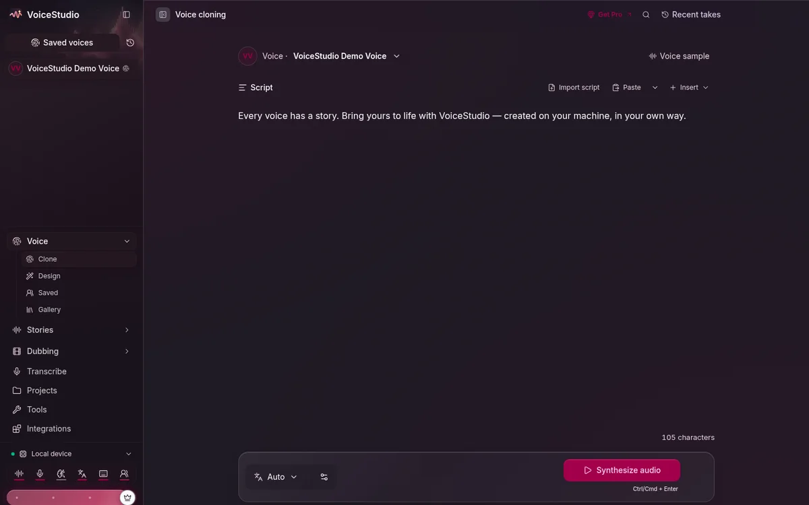
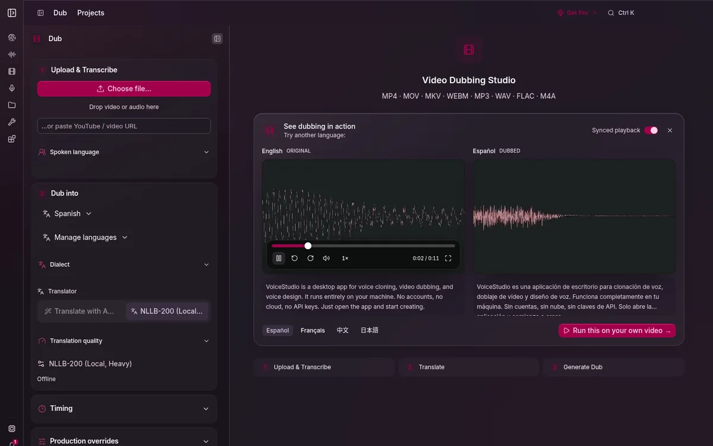
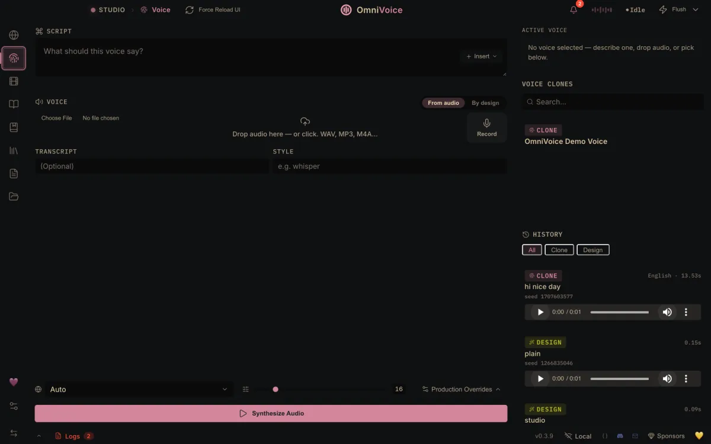
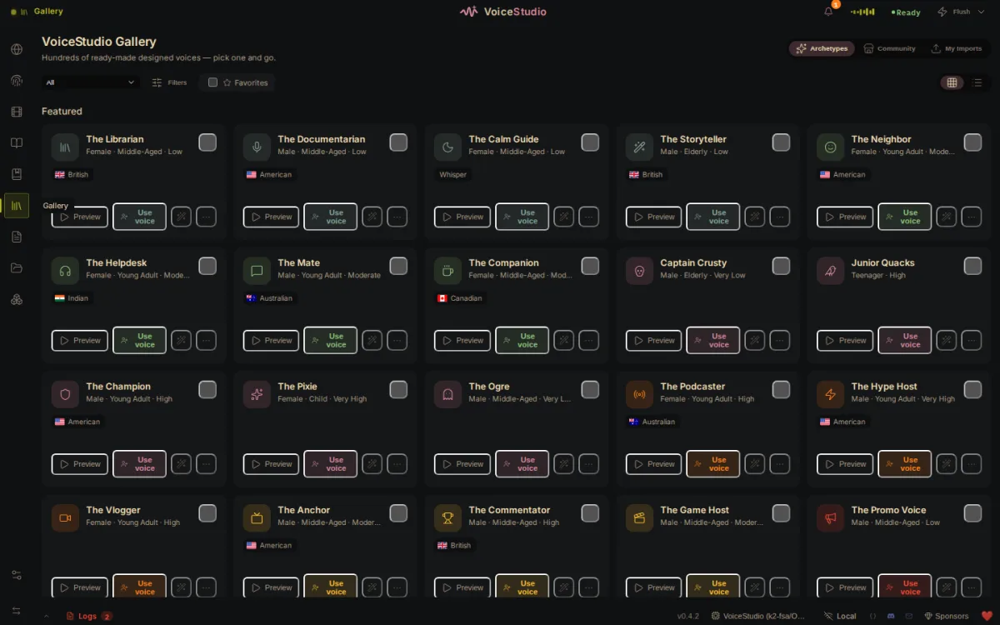
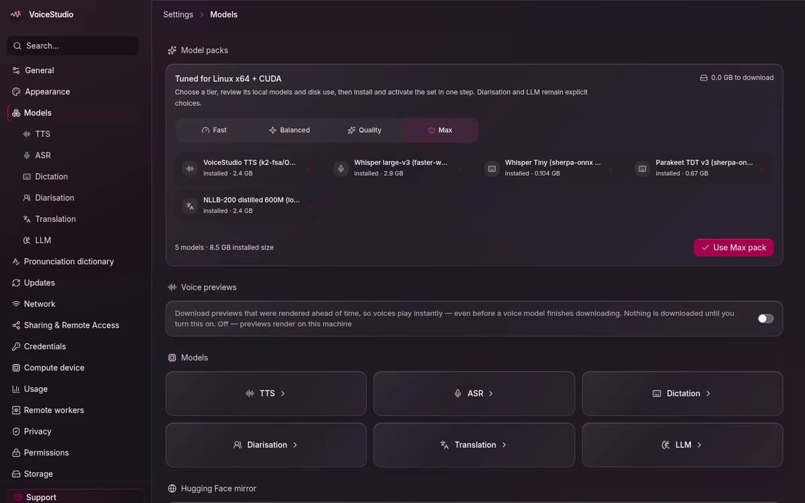
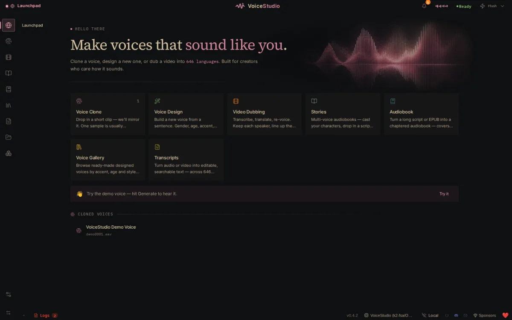

<div align="center">

# VoiceStudio on Colab: free GPU, full features

### Run the open-source ElevenLabs alternative on a free Colab T4. Your PC only shows the UI.

[](https://github.com/NurMohammadDuari/VoiceStudio-Colab-GPU)
[](https://github.com/NurMohammadDuari/VoiceStudio-Colab-GPU/network/members)
[](https://github.com/NurMohammadDuari/VoiceStudio-Colab-GPU/watchers)
[](LICENSE)
[](https://github.com/NurMohammadDuari/VoiceStudio-Colab-GPU/commits/main)
[](https://colab.research.google.com/)[](https://github.com/NurMohammadDuari/VoiceStudio-Colab-GPU/actions/workflows/validate.yml)[](https://github.com/NurMohammadDuari/VoiceStudio-Colab-GPU/releases)

**VoiceStudio + Colab + free GPU = professional AI voice studio at zero cost.**
Voice cloning, video dubbing, text-to-speech, transcription, dictation and
audiobooks — running on a **free Google Colab T4 GPU**, while your computer does
nothing but show the interface.

</div>

---

## Why this exists

[VoiceStudio](https://github.com/debpalash/VoiceStudio) is a free, AGPL-3.0,
open-source AI voice studio — a genuine **ElevenLabs alternative** with voice
cloning, video dubbing and 646 languages. It is #1 on GitHub Trending with 50k+
stars.

The catch: it assumes your PC has a GPU. **This repo removes that requirement.**
You get a free T4 from Google Colab, and the desktop app connects to it.

| | ElevenLabs Cloud | VoiceStudio Pro | **This repo** |
|---|---|---|---|
| Cost | from $6/mo | $99/yr | **Free** |
| GPU needed | none | yes, yours | **none — free Colab T4** |
| Voice cloning | yes | yes | **yes** |
| Video dubbing | yes | yes | **yes** |
| Languages | 74 on paid | 646 | **646** |
| Your audio | uploaded | stays local | **stays local** |
| Source code | closed | closed | **open (AGPL-3.0)** |

That middle column is the point: VoiceStudio's own paid **Pro** plan sells
"remote GPU workers" and "multiple devices". This does the same thing, free.

---

## Screenshots

The real app, running on a free Colab T4 — your PC shows this, the GPU is
somewhere else entirely.

<table>
<tr>
  <td width="50%"><br><sub><b>Voice cloning</b> — clone a voice from 3 seconds</sub></td>
  <td width="50%"><br><sub><b>Video dubbing</b> — per-speaker transcript and language columns</sub></td>
</tr>
<tr>
  <td><br><sub><b>Studio</b> — script, style controls, synthesize</sub></td>
  <td><br><sub><b>Voice gallery</b> — ready-made voices with previews</sub></td>
</tr>
<tr>
  <td><br><sub><b>Model catalogue</b> — every model with status and install actions</sub></td>
  <td><br><sub><b>Launchpad</b> — one screen for every workflow</sub></td>
</tr>
</table>

<sub>Screenshots of
[debpalash/VoiceStudio](https://github.com/debpalash/VoiceStudio), the AGPL-3.0
app this repo configures.</sub>

---

## Quick start (3 steps)

1. **Open the notebook** →
   [`notebook/VoiceStudio-Colab-GPU.ipynb`](notebook/VoiceStudio-Colab-GPU.ipynb)
   in [Google Colab](https://colab.research.google.com/).
2. **Runtime → Change runtime type → T4 GPU**, then **Runtime → Run all**.
3. Scroll to the end: it prints a **URL** and an **API key**. On your PC run
   `./scripts/install-launcher.sh`, double-click the **VoiceStudio** icon, and
   paste both.

Full walkthrough: **[docs/INSTALL.md](docs/INSTALL.md)**

---

## What you get

| Feature | Status |
|---|---|
| 🎙️ **Voice cloning** — clone a voice from 3 seconds of audio | works (OmniVoice) |
| 🎨 **Voice design** — describe a voice, get it | works |
| 🎬 **Video dubbing** — any video, any language, same timing | works (optional speaker-diarisation box) |
| 📝 **Text-to-speech / TTS** at Max quality (64 steps) | works |
| 🎧 **Dictation & transcription** | works (faster-whisper large-v3) |
| 🌍 **Translation in 646 languages** | works (NLLB) |
| 📚 **Audiobooks & Stories** | works |
| 🧩 **Local API (OpenAI-compatible) + MCP server** | works |
| ⚡ **GPU Turbo** — FlashInfer CUDA graphs, ~2× faster | on by default |
| 🔓 **Every settings panel, model install, engine switch** | unlocked by the API key |
| 💾 **Save audio/video to your PC** | works (direct HTTPS download) |

---

## How it works

```
   YOUR PC                      COLAB (free T4)              PUBLIC
┌──────────────┐   HTTPS   ┌────────────────────┐
│ VoiceStudio  │───────────▶│  backend :3900     │
│  (UI only)   │◀───────────│  OmniVoice + Whisper│
│              │            │  + NLLB + pyannote  │
└──────────────┘            └─────────┬──────────┘
                                      │ 127.0.0.1
                                      ▼
                        cloudflared quick tunnel
                     (random *.trycloudflare.com URL)
```

Deep dive: **[docs/ARCHITECTURE.md](docs/ARCHITECTURE.md)**

---

## Use cases

* **Dubbing videos** into other languages on a budget
* **Audiobooks** from a text file, on a GPU you don't own
* **Voice cloning** for narration, prototypes and accessibility
* **Transcribing** meetings, lectures and interviews
* **Learning** the ElevenLabs API on your own hardware, for free
* **Trying GPU text-to-speech** before renting an actual GPU

---

## When Colab restarts

Colab recycles its VM — that is normal.

| What happened | What to run | Re-paste |
|---|---|---|
| Tab reconnected, kernel restarted | box 2 | new URL (key unchanged) |
| Fresh VM (`/content` wiped) | box 1 → box 2 | new URL (key unchanged) |
| Lost the URL/key | box 4 | reprint |

Models, settings, cloned voices **and your API key** persist to Google Drive, so
a reset no longer means a 5 GB re-download.

---

## Documentation

| Document | What's inside |
|---|---|
| 📖 [INSTALL.md](docs/INSTALL.md) | Step-by-step setup for first run and every run after |
| 🏗 [ARCHITECTURE.md](docs/ARCHITECTURE.md) | Components, environment variables, the key handshake |
| 🔍 [HOW-IT-WORKS-IN-THE-APP.md](docs/HOW-IT-WORKS-IN-THE-APP.md) | Source analysis: security gates, routes, tiers, licences |
| 🛟 [TROUBLESHOOTING.md](docs/TROUBLESHOOTING.md) | Every error message → what it means → how to fix it |
| 🔒 [SECURITY.md](docs/SECURITY.md) | Threat model, key handling, residual risks |
| ❓ [FAQ.md](docs/FAQ.md) | Cost, privacy, speed, commercial use |

---

## Honest limits

* **Colab caps GPU hours** and disconnects idle tabs. Nothing fixes that from
  outside — for 24/7, rent a GPU box (RunPod, Vast.ai); nothing else changes.
* **The free T4 is Turing (sm75)**, so GPU Turbo may not be available there. The
  notebook detects this and continues without it.
* **The default model is CC-BY-NC** — personal and research use, not resale.
* A few buttons stay disabled: they act on the *backend host's* filesystem,
  which can never be your PC over a tunnel. Saving audio is unaffected.

---

## Contributing

Issues and pull requests are welcome — see [CONTRIBUTING.md](CONTRIBUTING.md).
Especially useful: reports of which platforms/CUDA builds work, and
translations of the docs.

If this saved you money, a ⭐ **star** helps other people find it.

## License

AGPL-3.0 — matching the [VoiceStudio](https://github.com/debpalash/VoiceStudio)
app it configures. This repository contains only a notebook, a launcher and
documentation; the application itself is not vendored here.

## Related

* [debpalash/VoiceStudio](https://github.com/debpalash/VoiceStudio) — the app
* [VoiceStudio Pro](https://voicestudio.sh/pro) / [Cloud](https://voicestudio.sh/cloud)
* [ElevenLabs](https://elevenlabs.io) — the hosted commercial alternative